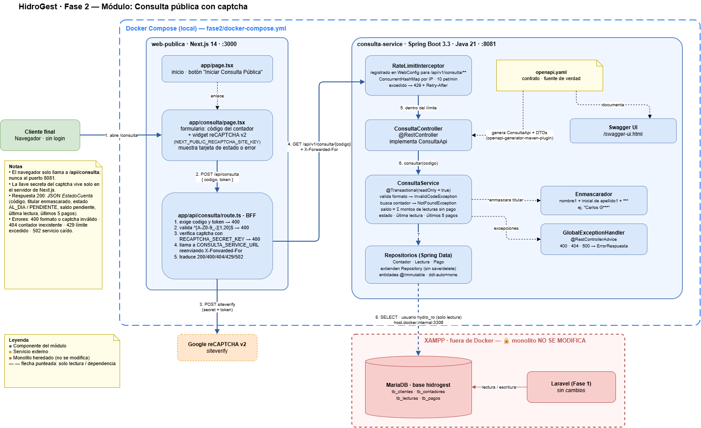

Nombre: Tulio René Alejandro Quintana Amézquita

Carnet: 0905-23-5024

Repositorio: https://github.com/HydroGest-Team/Consulta_Captcha

Modulo asignado: Consulta pública con captcha

---

# 💧 HidroGest — Fase 2: Consulta pública con captcha

Módulo de la Fase 2 del sistema **HidroGest (Oficina del Agua)**. Agrega una página pública, sin inicio de sesión, donde un cliente consulta el **estado de cuenta** de su servicio escribiendo el **código de su contador** y resolviendo un **reCAPTCHA**.

El módulo se construyó **al lado** del monolito heredado (Laravel + MariaDB), sin modificar ninguno de sus archivos, migraciones ni tablas.

---

## 1. Funcionalidad y objetivo

### Problema de negocio
En la Fase 1, el estado de cuenta solo era visible dentro del sistema, para usuarios con sesión (administrador, lector, cajero). Un cliente que quería saber si tenía saldo pendiente debía llamar o presentarse en la oficina, lo que generaba carga de atención y consultas repetitivas.

### Qué se construyó
Una consulta de autoservicio abierta al público que muestra, para un contador:

| Dato | Descripción |
|---|---|
| Código del contador | El código ingresado (ej. `CTR-001`) |
| Titular | Nombre **enmascarado**: primer nombre + inicial del primer apellido + `***` (ej. `Carlos G***`) |
| Estado | `AL_DIA` o `PENDIENTE` |
| Saldo pendiente | Suma de los montos de las lecturas que aún no tienen pago, en quetzales |
| Última lectura | Fecha, lectura del medidor y consumo en m³ |
| Últimos pagos | Los 5 pagos más recientes (fecha y monto) |

Las reglas de cálculo son las mismas que usa el `DashboardController` del monolito: una lectura está pendiente si no tiene un registro asociado en `tb_pagos`, de modo que la consulta pública muestra exactamente lo mismo que el sistema interno.

### Cómo funciona
1. El cliente abre la página pública, escribe el código de su contador y resuelve el reCAPTCHA.
2. El navegador envía el código y el token del captcha **únicamente** al BFF de Next.js.
3. El BFF valida el formato del código, verifica el captcha con Google desde el servidor y, si es válido, consulta al microservicio.
4. El microservicio aplica el límite de peticiones por IP, lee la base de datos del monolito en **modo solo lectura** y devuelve el estado de cuenta.
5. La página muestra el resultado en una tarjeta o un mensaje de error claro (código inexistente, captcha inválido, demasiadas peticiones).

---

## 2. Integración y responsabilidades

### Componentes del módulo

| Componente | Tecnología | Puerto | Responsabilidad |
|---|---|---|---|
| `web-publica` | Next.js 14 (App Router) | 3000 | Página pública `/consulta` y **BFF** en `/api/consulta`: valida el formato, verifica el reCAPTCHA en el servidor y llama al microservicio |
| `consulta-service` | Spring Boot 3.3 · Java 21 | 8081 | API REST definida por contrato OpenAPI. Aplica rate limit por IP, lee la BD del monolito y enmascara datos personales |
| Base de datos del monolito | MariaDB (XAMPP), base `hidrogest` | 3306 | Fuente de datos. Se accede **solo con `SELECT`** mediante el usuario `hydro_ro` |
| Google reCAPTCHA v2 | Servicio externo | — | Verificación del token del captcha (`siteverify`) |

### Diagrama de arquitectura del módulo



Archivo editable: [`fase2/docs/consulta-publica/arquitectura-consulta-publica.drawio`](fase2/docs/consulta-publica/arquitectura-consulta-publica.drawio)

### Flujo de comunicación

```
[Navegador del cliente]
        │  POST /api/consulta  { codigo, token }
        ▼
[web-publica · Next.js BFF :3000] ───── POST siteverify ─────▶ [Google reCAPTCHA]
        │  1. valida formato del código
        │  2. verifica el captcha (lado servidor)
        │  GET /api/v1/consulta/{codigo}   (cabecera X-Forwarded-For con la IP del cliente)
        ▼
[consulta-service · Spring Boot :8081]
        │  1. rate limit por IP (10 peticiones/minuto)
        │  2. consultas de solo lectura con el usuario hydro_ro
        ▼
[MariaDB · base hidrogest]  ◀── usada también por el monolito Laravel (sin cambios)
```

### Fronteras y por qué se definieron así

- **El monolito heredado no se modifica.** Todo el módulo vive en la carpeta `fase2/`. No se agregaron rutas, controladores, vistas, migraciones ni endpoints en Laravel. Así el trabajo aprobado de la Fase 1 no corre riesgo.
- **El navegador nunca habla con el microservicio ni con la base de datos.** Solo conoce `/api/consulta` del BFF. El puerto 8081 no aparece en el código del cliente, lo que se puede comprobar en la pestaña *Red* del navegador.
- **La llave secreta del captcha no llega al navegador.** Solo la llave pública (`NEXT_PUBLIC_RECAPTCHA_SITE_KEY`) se usa en el cliente; la secreta (`RECAPTCHA_SECRET_KEY`) existe únicamente en el servidor de Next.js.
- **Acceso de solo lectura en tres capas:**
  1. Usuario de base de datos `hydro_ro` con permiso únicamente `SELECT`. Un `UPDATE` responde `ERROR 1142 ... command denied`.
  2. `spring.jpa.hibernate.ddl-auto=none`: Hibernate nunca crea ni altera tablas.
  3. Entidades JPA marcadas con `@Immutable`.
- **Datos personales protegidos.** Nunca se devuelven DPI, teléfono, dirección ni IDs internos, y el nombre del titular se entrega enmascarado.

### Tablas del monolito que se leen

| Tabla | Columnas utilizadas |
|---|---|
| `tb_clientes` | `id`, `nombre1_cliente`, `apellido1_cliente` |
| `tb_contadores` | `id`, `codigo_contador`, `cliente_id` |
| `tb_lecturas` | `id`, `lectura_actual`, `consumo`, `monto`, `fecha_lectura`, `contador_id` |
| `tb_pagos` | `id`, `monto_pago`, `fecha_pago`, `lecturas_id` |

El detalle de las consultas está en [`fase2/docs/consulta-publica/ESQUEMA.md`](fase2/docs/consulta-publica/ESQUEMA.md).

### Contrato de la API

El contrato se definió **antes** del código (*contract-first*) en [`fase2/consulta-service/src/main/resources/static/openapi.yaml`](fase2/consulta-service/src/main/resources/static/openapi.yaml). En cada compilación, `openapi-generator-maven-plugin` genera la interfaz `ConsultaApi` y los DTOs (`EstadoCuenta`, `UltimaLectura`, `PagoResumen`, `ErrorRespuesta`), y `ConsultaController` implementa esa interfaz.

| Método | Ruta | Respuestas |
|---|---|---|
| `GET` | `/api/v1/consulta/{codigoContador}` | `200` estado de cuenta · `400` formato inválido · `404` contador no existe · `429` límite excedido (con `Retry-After`) · `500` error interno |

El código debe cumplir el patrón `^[A-Z0-9_-]{1,20}$`, validado tanto en el BFF como en el microservicio.

---

## 3. Decisiones técnicas

### 3.1 Dos barreras independientes: captcha en el BFF + rate limit por IP en el microservicio

**Problema:** la página es pública y los códigos de contador siguen un patrón predecible (`CTR-001`, `CTR-002`…). Sin protección, un script podría recorrerlos todos y extraer el padrón de clientes con su situación de pago.

**Decisión:** usar dos controles en capas distintas.

- **reCAPTCHA v2, verificado en el servidor del BFF.** Es la primera barrera: obliga a que cada consulta la inicie una persona. Se verifica en el servidor porque una validación hecha solo en el navegador se puede saltar llamando directamente a la API.
- **Rate limit de 10 peticiones por minuto por IP, en el microservicio.** Es la segunda barrera y no depende de la primera. Protege aunque el captcha falle, se resuelva con un servicio de terceros, o alguien llegue al microservicio sin pasar por el BFF. Cuando se excede, responde `429` con la cabecera `Retry-After`.

**Por qué no solo el captcha:** un captcha se puede resolver de forma automatizada o comprar a servicios externos, y no protege al microservicio si alguien lo llama directamente. **Por qué no solo el rate limit:** un atacante podría repartir las consultas entre muchas IPs. Juntos cubren los dos casos.

**Implementación del rate limit:** un `HandlerInterceptor` con un `ConcurrentHashMap` en memoria y ventana de 1 minuto, con limpieza periódica de entradas vencidas. Se eligió frente a una librería como Bucket4j o un almacén externo como Redis porque el servicio corre como **un solo contenedor**, y así no se agrega infraestructura. El BFF reenvía la IP real del cliente en `X-Forwarded-For` para que el límite se aplique por cliente y no por la IP del BFF.
*Limitación conocida:* si el servicio se escalara a varias réplicas, el contador debería moverse a un almacén compartido (por ejemplo Redis).

### 3.2 Next.js como BFF en lugar de llamar directo al microservicio

El navegador podría llamar al microservicio Spring Boot, pero eso obligaría a exponer su puerto, a habilitar CORS y a mover la verificación del captcha a Java. Con el BFF, la página y su API viven en el mismo origen, la llave secreta del captcha queda en el servidor de Next.js, y el microservicio puede quedar en una red interna.

### 3.3 Contract-first con OpenAPI

El YAML del contrato es la fuente de verdad: las interfaces y DTOs de Java se generan a partir de él. Así el contrato y la implementación no se pueden desalinear, y cualquiera puede revisar la API en Swagger UI sin leer el código.

El registro completo de decisiones está en [`fase2/docs/consulta-publica/DECISIONES.md`](fase2/docs/consulta-publica/DECISIONES.md).

---

## 4. Instrucciones para probar el módulo

### 4.1 Requisitos previos

- Docker Desktop (para levantar con `docker compose`), o bien JDK 21 y Node.js 20+ para ejecutarlo sin Docker.
- El monolito HidroGest con su base `hidrogest` corriendo en MariaDB (XAMPP) en el puerto `3306`, con los datos de prueba del seeder.

### 4.2 Crear el usuario de solo lectura (una sola vez)

Ejecutar como `root` en MariaDB, reemplazando `TU_CLAVE` por una contraseña propia:

```sql
CREATE USER IF NOT EXISTS 'hydro_ro'@'localhost' IDENTIFIED BY 'TU_CLAVE';
CREATE USER IF NOT EXISTS 'hydro_ro'@'%'         IDENTIFIED BY 'TU_CLAVE';
GRANT SELECT ON hidrogest.* TO 'hydro_ro'@'localhost';
GRANT SELECT ON hidrogest.* TO 'hydro_ro'@'%';
FLUSH PRIVILEGES;
```

### 4.3 Levantar los servicios con Docker Compose

```powershell
cd fase2
Copy-Item .env.example .env      # en Linux/macOS: cp .env.example .env
# Editar .env y colocar en HYDRO_RO_PASSWORD la clave definida en el paso anterior
docker compose up --build
```

Variables del archivo `.env`:

| Variable | Uso |
|---|---|
| `HYDRO_RO_PASSWORD` | Contraseña del usuario `hydro_ro` |
| `NEXT_PUBLIC_RECAPTCHA_SITE_KEY` | Llave pública del reCAPTCHA |
| `RECAPTCHA_SECRET_KEY` | Llave secreta del reCAPTCHA (solo servidor) |

> Las llaves de reCAPTCHA incluidas en `.env.example` son las **llaves de prueba públicas que publica Google**: el captcha siempre se valida y solo sirven en `localhost`. No son credenciales reales. Para un entorno real deben generarse llaves propias. El archivo `.env` está en `.gitignore` y no se sube al repositorio.

### 4.4 Levantar sin Docker (alternativa)

**Terminal 1 — microservicio**
```powershell
cd fase2\consulta-service
$env:DB_URL = "jdbc:mariadb://localhost:3306/hidrogest"
$env:DB_PASSWORD = "TU_CLAVE"
.\mvnw.cmd spring-boot:run
```

**Terminal 2 — página pública y BFF**
Crear `fase2\web-publica\.env.local` con las dos llaves de reCAPTCHA de `fase2\.env.example` y `CONSULTA_SERVICE_URL=http://localhost:8081`, y luego:
```powershell
cd fase2\web-publica
npm install
npm run dev
```

### 4.5 URLs

| Recurso | URL |
|---|---|
| Página pública de consulta | http://localhost:3000/consulta |
| Swagger UI del microservicio | http://localhost:8081/swagger-ui.html |

### 4.6 Datos de prueba

| Código | Resultado esperado |
|---|---|
| `CTR-001` | Estado **AL_DIA**, saldo Q0.00 |
| `CTR-002` | Estado **PENDIENTE** con saldo, después de ejecutar como `root` el script [`fase2/docs/consulta-publica/sql/02-dato-prueba-deuda.sql`](fase2/docs/consulta-publica/sql/02-dato-prueba-deuda.sql) (agrega una lectura sin pago; al final del script está la instrucción para quitarla) |
| `CTR-999` | Mensaje "No existe un contador con ese código" |

### 4.7 Flujo de prueba

1. Abrir http://localhost:3000/consulta.
2. Escribir `CTR-001`, marcar el reCAPTCHA y presionar **Consultar**.
3. **Resultado esperado:** tarjeta con el titular enmascarado, estado `AL_DIA`, saldo, última lectura y últimos pagos. Los valores coinciden con el dashboard del monolito para ese contador.
4. Repetir con `CTR-002` (tras el script de deuda): estado `PENDIENTE` y el saldo correspondiente.
5. Repetir con `CTR-999`: mensaje de contador inexistente.
6. Abrir F12 → pestaña **Red**: el navegador solo llama a `/api/consulta`, nunca al puerto 8081.

### 4.8 Pruebas de aceptación

| # | Prueba | Resultado esperado |
|---|---|---|
| 1 | `CTR-001` + captcha en la página | Estado de cuenta igual al del dashboard de Laravel |
| 2 | `CTR-999` | `404` — "No existe un contador con ese codigo" |
| 3 | `ctr@001` directo al puerto 8081 | `400` — formato inválido |
| 4 | 15 peticiones seguidas al puerto 8081 | 10 respuestas `200` y 5 respuestas `429` |
| 5 | `UPDATE` conectado como `hydro_ro` | `ERROR 1142 ... command denied` |
| 6 | Swagger UI | Muestra el contrato completo |
| 7 | F12 → Red en la página | Solo aparece `/api/consulta` |
| 8 | `docker compose up --build` | Ambos servicios levantan y la consulta funciona |
| 9 | `git status` sobre los archivos del monolito | Ningún archivo de Laravel modificado |

**Prueba del rate limit (PowerShell):**
```powershell
1..15 | ForEach-Object { curl.exe -s -o NUL -w "%{http_code}`n" http://localhost:8081/api/v1/consulta/CTR-001 }
```

**Pruebas unitarias** (enmascarado del titular, sin base de datos):
```powershell
cd fase2\consulta-service
.\mvnw.cmd test
```

---

## 5. Estructura del módulo

```
fase2/
├── docker-compose.yml           # consulta-service + web-publica
├── .env.example                 # plantilla de variables (sin secretos reales)
├── consulta-service/            # Spring Boot 3.3 · Java 21
│   ├── pom.xml                  # incluye openapi-generator-maven-plugin
│   ├── Dockerfile
│   └── src/main/
│       ├── java/com/hydrogest/consulta/
│       │   ├── controller/      # ConsultaController (implementa ConsultaApi)
│       │   ├── service/         # ConsultaService, Enmascarador
│       │   ├── repository/      # Contador, Lectura y Pago (Spring Data JPA)
│       │   ├── entity/          # entidades @Immutable
│       │   ├── interceptor/     # RateLimitInterceptor
│       │   ├── config/          # WebConfig
│       │   └── exception/       # manejo global de errores
│       └── resources/
│           ├── application.properties
│           └── static/openapi.yaml   # contrato (fuente de verdad)
├── web-publica/                 # Next.js 14
│   ├── Dockerfile
│   └── app/
│       ├── consulta/page.tsx    # página pública con reCAPTCHA
│       └── api/consulta/route.ts# BFF
└── docs/consulta-publica/
    ├── README.md
    ├── ESQUEMA.md
    ├── DECISIONES.md
    └── sql/                     # usuario de solo lectura y dato de prueba
```

---

## 6. Seguridad de la información

- No se publican contraseñas, tokens ni archivos `.env`; las credenciales se pasan por variables de entorno.
- El archivo `.env.example` contiene solo marcadores y las llaves de prueba públicas de Google reCAPTCHA.
- Limitación conocida: en ejecución local el puerto 8081 queda publicado para poder usar Swagger. En un despliegue real no debe exponerse; solo el BFF debería poder alcanzarlo.
